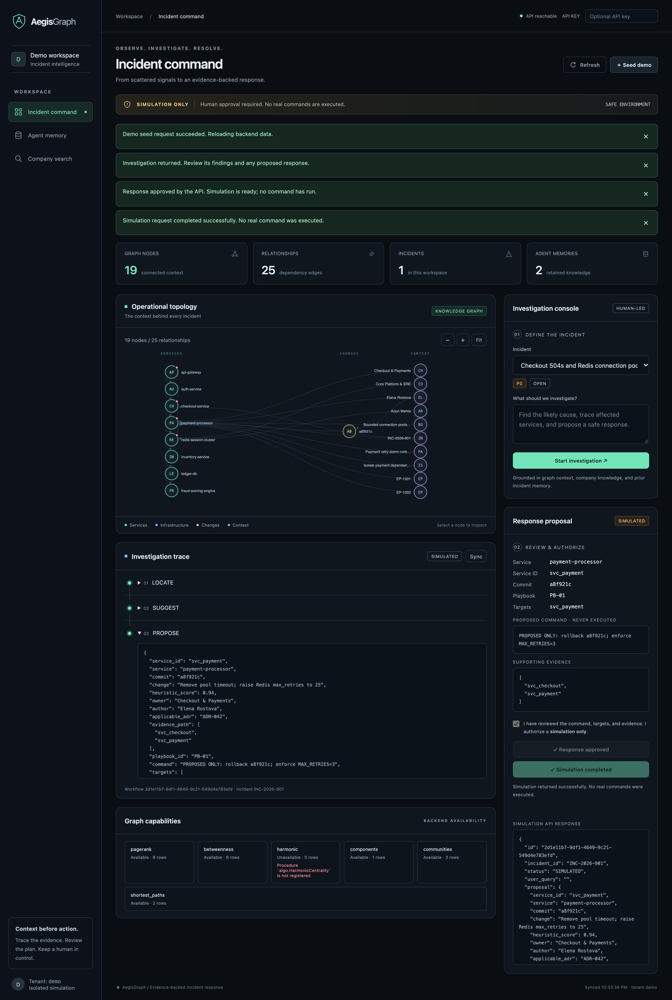
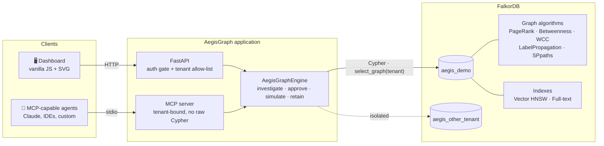
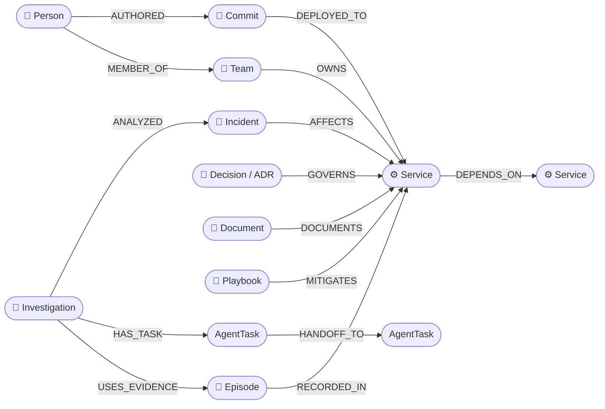
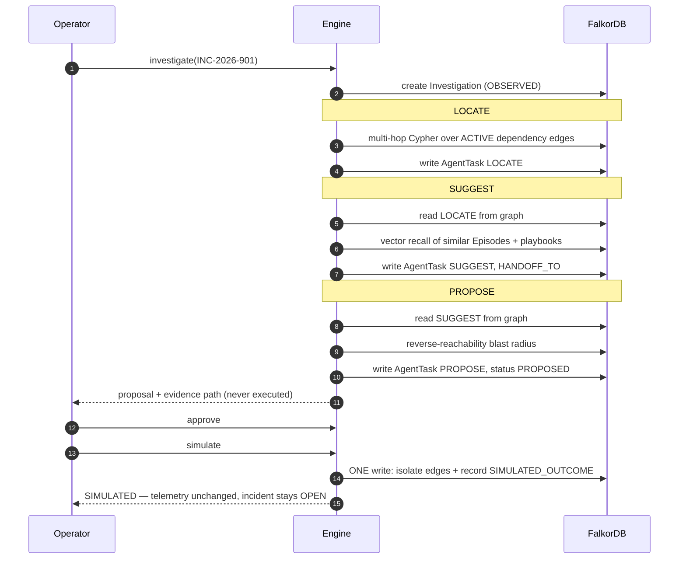
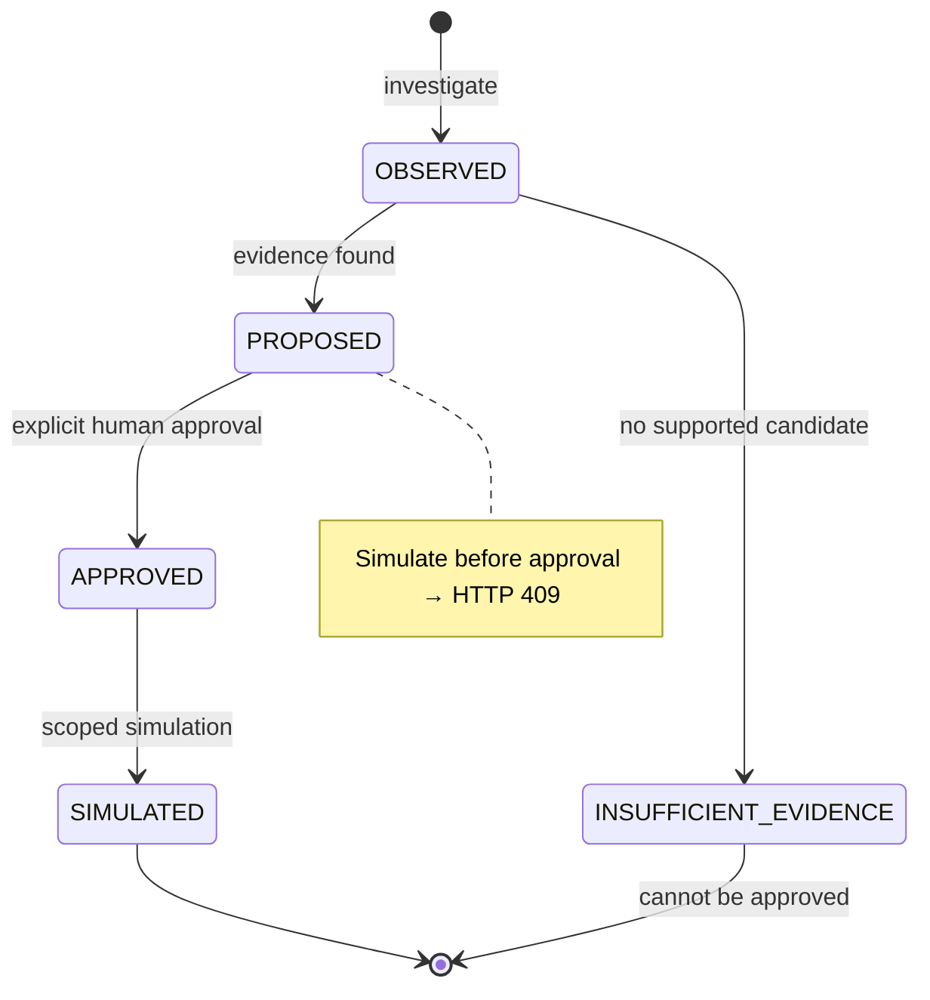

<div align="center">

# 🛡️ AegisGraph

### Stop guessing. Follow the graph.
**An agent that investigates production incidents by following a FalkorDB graph — and shows the path behind every answer.**

[](https://www.falkordb.com/)
[](https://www.python.org/)
[](https://fastapi.tiangolo.com/)
[](https://modelcontextprotocol.io/)
[](#-tests)
[](https://www.wemakedevs.org/hackathons/falkordb)

<br/>



<sub>The real dashboard, captured after: seed → investigate → approve → simulate. Nothing here is mocked.</sub>

</div>

---

## ✨ The 30-second pitch

When checkout starts returning 504s, the cause is rarely where the alert fires. It is **three hops downstream**: a commit that removed a connection-pool timeout, owned by a different team, in violation of an architecture decision written a year ago.

A vector search over runbooks finds *text about timeouts*. It cannot answer:

> **Which deployed commit? Who wrote it? Who owns the service? Which decision governs it? What else breaks if we isolate it?**

Those are **graph questions**. AegisGraph puts topology, deployments, people, teams, ADRs, runbooks, playbooks and agent memory into one FalkorDB property graph, then uses the graph — not a prompt — to do the work.

**And it refuses to lie.** No evidence → `INSUFFICIENT_EVIDENCE`, not a confident guess. No approval → no action. A *simulated* mitigation is never recorded as a *real* recovery.

---

## 🧭 Table of contents

[Why it stands out](#-why-it-stands-out) · [Architecture](#-architecture) · [Graph model](#-the-graph-model) · [Workflow](#-the-investigation-workflow) · [FalkorDB features](#-how-falkordb-is-used) · [Track 01](#-hackathon-track-01--agents-that-act-on-connected-data) · [Quick start](#-quick-start) · [MCP](#-mcp-server) · [API](#-http-api) · [Safety](#-safety-by-design) · [Tests](#-tests) · [Config](#-configuration) · [Limitations](#-honest-limitations) · [Roadmap](#-roadmap)

---

## 🏆 Why it stands out

| | Typical "AI agent" demo | **AegisGraph** |
|---|---|---|
| **Context** | Chunks of text in a vector store | A connected graph: services → deploys → authors → owners → decisions |
| **Reasoning** | One big prompt | Bounded multi-hop Cypher with evidence paths you can inspect |
| **Agent memory** | In-process variables, lost on restart | `AgentTask` nodes + `HANDOFF_TO` edges; **resumes from persisted state** |
| **When it doesn't know** | Hallucinates a plausible answer | Returns `INSUFFICIENT_EVIDENCE` and creates no proposal |
| **Taking action** | Runs whatever the model suggests | Human approval gate → **scoped, simulation-only** change |
| **Honesty** | "Resolved!" | Labels heuristics as heuristics; outcome memory is `SIMULATED_OUTCOME` |
| **Without the database** | Still mostly works | Stops working — the graph *is* the product |
| **Failure mode** | Silent fallback to fake data | Explicit `503`, no fallback data, ever |

**Also included:** an MCP server for any MCP-capable agent, a zero-dependency dashboard (no CDN, vanilla JS + SVG), per-tenant graph isolation, and real integration tests against FalkorDB.

---

## 🏗️ Architecture



Every read and write goes through the engine, and the engine only talks to FalkorDB. If the database is unreachable, requests fail loudly (`503`) instead of quietly serving made-up data.

---

## 🕸️ The graph model

One unified graph answers *technical*, *organizational* and *memory* questions together.



Ownership (`OWNS`) and authorship (`AUTHORED`) are resolved **separately** on purpose: the person who wrote a commit is not necessarily on the team that owns the service.

---

## 🔄 The investigation workflow

Three deterministic stages hand work to each other **through the graph**. Each stage reads its predecessor's *persisted* output — so if the process dies after `LOCATE`, a restart resumes at `SUGGEST` without redoing work.



### Investigation states



### How a candidate cause is chosen

A service/commit pair becomes a candidate only if **all** of these hold:

- ✅ The service is reachable from the incident's affected entry point over **active** dependency edges (≤ 3 hops)
- ✅ The service is currently `DEGRADED` or `CRITICAL`
- ✅ A commit was deployed to it **before** the incident, **within 24 hours**, in the **same environment**
- ✅ Any governing ADR is `ACCEPTED` and was valid at incident time

Candidates carry a **labeled heuristic score** — not a fake "96% confidence" — and an explicit `evidence_path`. Graph connectivity is evidence, not proof of causality, and the UI says so.

---

## 🔬 How FalkorDB is used

> **Remove FalkorDB and the product stops working.** That is the test the hackathon asks for, and it is the design goal here.

| Capability | Where it appears |
|---|---|
| **Graph algorithms** | `algo.pageRank`, `betweenness`, `WCC`, `labelPropagation` and `algo.SPpaths` (latency-weighted paths) run over the live topology. `HarmonicCentrality` is attempted; it is *not registered* in the tested server image or embedded build, so it is reported **unavailable** rather than faked. |
| **Multi-hop Cypher** | Variable-length paths filtered on relationship `status` for localization; reverse reachability for blast radius. |
| **Vector index** | `CREATE VECTOR INDEX … {dimension: 8, similarityFunction: 'cosine'}` + `db.idx.vector.queryNodes` for episode recall. *(8-d keyword features — reproducible, not a learned embedding model.)* |
| **Full-text index** | `db.idx.fulltext.createNodeIndex` over runbooks for company search. |
| **Workflow state in the graph** | `AgentTask` + `HANDOFF_TO` replace in-process variables, so handoffs survive restarts. |
| **Topology mutation** | Approved simulation swaps `DEPENDS_ON` for `ISOLATED_DEPENDENCY` — later algorithm calls see the changed graph. |
| **Multigraph tenancy** | One graph per tenant via `select_graph("aegis_<tenant>")`. |
| **Atomic outcome** | Topology change and outcome memory commit in a **single** Cypher write. |

---

## 🎯 Hackathon Track 01 — Agents That Act on Connected Data

Built for **Graph Hacks: Context for AI Agents** (WeMakeDevs × FalkorDB). The task: *pick a problem where the answer depends on how things connect, and build the agent that handles it.* Ours is production incident triage — "what breaks, what changed, who owns it, and what should we do?"

| Track 01 focus | How AegisGraph delivers it |
|---|---|
| **Multi-hop reasoning** | Bounded variable-length Cypher walks from an incident to affected services, their deployments, authors, owning teams and governing ADRs. |
| **Graph queries & algorithms as agent tools** | PageRank, betweenness, connected components, label propagation and weighted shortest paths run in FalkorDB and are exposed through the API and MCP. |
| **Tool selection through MCP** | A tenant-bound MCP server lets any MCP-capable agent pick graph tools (`investigate_incident`, `graph_algorithms`, …) — with no raw Cypher and no approval power. |
| **Actions based on what the graph shows** | The proposed mitigation is derived from graph topology; after human approval, a scoped simulation rewires the graph and later analysis reflects it. |
| **Explainable results** | Every proposal carries its evidence path, applicable ADR, owner, author, blast radius and the persisted `LOCATE → SUGGEST → PROPOSE` trace. |

---

## 🚀 Quick start

**Fastest path — embedded FalkorDB, no Docker:**

```sh
git clone https://github.com/krish57-bit/aegisgraph-falkordb.git
cd aegisgraph-falkordb

python3 -m venv .venv && . .venv/bin/activate
pip install -r requirements.txt falkordblite==0.10.0

GRAPH_MODE=embedded uvicorn backend.main:app --host 127.0.0.1 --port 8000
# → open http://127.0.0.1:8000 and click "Seed demo"
```

**With a real FalkorDB server (Docker):**

```sh
pip install -r requirements.txt
docker compose up -d --wait            # falkordb/falkordb:v4.14.9 on 127.0.0.1:6379
uvicorn backend.main:app --host 127.0.0.1 --port 8000
```

> `GRAPH_MODE` defaults to `remote`. There is **no silent fallback** to embedded data — if the database is down you get a clear `503`, not fake results.

Tested with `falkordb==1.8.0` (client), `falkordblite==0.10.0` and the pinned Docker image on macOS/arm64, Python 3.14.

---

--|---|
| **0:00** | Click **Seed demo** | 19 nodes / 25 relationships load into the topology; one P0 incident appears |
| **0:30** | Look at **Graph capabilities** | Algorithms run in-database; harmonic centrality is honestly shown as *unavailable* |
| **0:50** | Pick the incident → **Start investigation** | `LOCATE → SUGGEST → PROPOSE` appear as persisted `AgentTask` stages |
| **1:20** | Open the proposal | `payment-processor`, commit `a8f921c`, owning team, `ADR-042`, blast radius, evidence path |
| **1:45** | Try to **Simulate** first | Disabled in the UI, and `409` from the API — **no approval, no action** |
| **2:05** | Tick the approval box → **Approve** → **Simulate** | Only edges into the approved service are isolated; telemetry unchanged; incident stays `OPEN` |
| **2:30** | **Agent memory** → preview retention | Dry run lists candidates; protected evidence is never archived |
| **2:50** | **Company search** → "payment" | Runbook via full-text + ownership via graph edges |

---

## 🔌 MCP server

Give any MCP-capable agent safe, tenant-bound access to the graph.

```sh
GRAPH_MODE=embedded python -m backend.mcp_server        # stdio transport
```

Example client configuration:

```json
{
  "mcpServers": {
    "aegisgraph": {
      "command": "/absolute/path/to/.venv/bin/python",
      "args": ["-m", "backend.mcp_server"],
      "cwd": "/absolute/path/to/aegisgraph-falkordb",
      "env": { "GRAPH_MODE": "embedded", "AEGIS_MCP_TENANT": "demo" }
    }
  }
}
```

| Tool | What it does |
|---|---|
| `read_graph` | Topology snapshot |
| `list_incidents` | Open incidents |
| `graph_algorithms` | Algorithm results + availability |
| `investigate_incident` | Run Locate → Suggest → Propose; persists a trace |
| `read_investigation` | Read a stored trace |
| `list_memories` | Episodic memories |
| `preview_memory_retention` | **Always dry-run** |
| `search_company_brain` | Runbooks + ownership |

**Deliberately absent:** raw Cypher, tenant switching, approval, simulation/execution, destructive flags. An agent can *investigate*; only a human can *approve*. Built on the MCP Python SDK 2.x (`MCPServer`).

---

## 🌐 HTTP API

All routes use header `X-Tenant-ID: demo` (must be allow-listed). Interactive docs at `/docs`.

| Method & path | Purpose |
|---|---|
| `GET /api/health` | Database reachability *(public)* |
| `POST /api/seed` | Idempotent tenant initialization |
| `GET /api/graph` · `/api/incidents` · `/api/algorithms` · `/api/memories` | Reads (an unseeded tenant reads as empty, not an error) |
| `POST /api/investigations` | Run the workflow → `PROPOSED` or `INSUFFICIENT_EVIDENCE` |
| `GET /api/investigations/{id}` · `POST …/{id}/resume` | Read / resume from persisted stages |
| `POST …/{id}/approve` → `POST …/{id}/simulate` | Explicit approval, then scoped simulation (`409` otherwise) |
| `POST /api/memories/retain` | `{threshold, dry_run: true}` — preview by default |
| `GET /api/search?q=` | Full-text runbooks + ownership |

---

## 🔒 Safety by design

Each property below is covered by a test.

- 🚫 **No guessing.** Unknown incident → `404`. No supported candidate → `INSUFFICIENT_EVIDENCE`, no proposal, cannot be approved.
- 🧑‍⚖️ **Approval gate.** Simulation requires prior approval, touches only approved targets, and is idempotent.
- 🪞 **Honest memory.** Unexecuted proposals never become success memories. The simulated outcome is labeled `SIMULATED_OUTCOME`; observed telemetry and incident status are left untouched.
- ⏱️ **Temporal sanity.** Candidates need a deployment inside the incident window, a matching environment, an active dependency path, and an *accepted* ADR valid at the time.
- 🗄️ **Careful retention.** Dry-run first, 24-hour grace period, **archive rather than delete**, protected evidence always skipped.
- 🔁 **Restart-safe.** An interrupted investigation resumes from the persisted `LOCATE` stage.
- 🧱 **Graceful degradation.** Optional algorithms report `available: false` instead of failing diagnosis or fabricating scores.
- 🏢 **Tenant isolation.** Tenant ids are validated (`[a-z][a-z0-9_]{0,47}`) and allow-listed — never silently rewritten, so `acme-prod` can't collide with `acmeprod`.
- 🔑 **Access control.** Loopback-only by default; non-local access requires `AEGIS_API_KEY`.

---

## 🧪 Tests

```sh
pip install pytest
pytest                          # 6 fast tests: tenant rules, API gating, error mapping
AEGIS_TEST_GRAPH=1 pytest       # + 7 integration tests against real embedded FalkorDB
```

**13 passing.** The integration tests exercise real seeding, vector search, algorithms, scoped simulation, resume-after-interruption, retention, concurrent workflows, and tenant separation.

Beyond the automated suite, the full workflow (seed → algorithms → investigate → approve → simulate → retention → search) was also run manually against the pinned `falkordb/falkordb:v4.14.9` container, an MCP stdio client completed a handshake and tool call, and the dashboard flow was driven end-to-end in Chrome.

---

## ⚙️ Configuration

| Variable | Meaning | Default |
|---|---|---|
| `GRAPH_MODE` | `remote` or `embedded` | `remote` |
| `FALKORDB_HOST` · `FALKORDB_PORT` · `FALKORDB_PASSWORD` | Remote connection | `localhost` · `6379` · *(none)* |
| `FALKORDB_PATH` | Embedded data file | `/tmp/aegisgraph.db` |
| `AEGIS_API_KEY` | Shared key sent as `X-API-Key`. **Required for non-loopback access.** | *(none)* |
| `AEGIS_ALLOWED_TENANTS` | Comma-separated tenant allow-list | `demo` |
| `AEGIS_MCP_TENANT` | Fixed tenant for the MCP server (must be allow-listed) | `demo` |

A shared key plus an allow-list is **not** per-user RBAC. Add real identity, TLS, and rate limiting before any real deployment.

---

## 📁 Project structure

```text
backend/
  graph_engine.py   # FalkorDB engine: seeding, algorithms, workflow, retention, search
  main.py           # FastAPI app, auth gate, error mapping
  mcp_server.py     # Tenant-bound, simulation-only MCP adapter
  seed.py           # Synthetic demo topology and company data
frontend/
  index.html        # Dashboard — no build step, no CDN
tests/
  test_api.py          # fast tests
  test_integration.py  # real-FalkorDB tests
docker-compose.yml  # pinned FalkorDB image, loopback-only, persistent volume
```

---

## ⚠️ Honest limitations

We would rather you hear these from us:

- **Deterministic stages, not LLM agents.** The three stages are plain code coordinating through the graph. An LLM layer could sit on top; the graph would remain the source of truth.
- **Heuristic ranking.** `risk_score` is seeded demo data. Output is a *ranked hypothesis with evidence*, not causal proof, and scores are not calibrated confidences.
- **Simulation only.** No production command is ever executed and there is no live executor.
- **Synthetic data.** One seeded incident; no real telemetry ingestion.
- **Keyword vectors.** The 8-d vectors are reproducible domain features, not a learned embedding model; the similarity threshold is untuned.
- **Single-process task claiming.** Handoffs are durable, but multi-worker leasing is not implemented.
- **`algo.HarmonicCentrality`** is not registered in `falkordb/falkordb:v4.14.9` or FalkorDBLite 0.10.0, so it is reported unavailable.

---

## 🗺️ Roadmap

*Not implemented yet — listed so the direction is clear.*

- [ ] LLM reasoning layer (e.g. via Backboard) that calls the same graph tools
- [ ] Real telemetry ingestion (Prometheus / OpenTelemetry → graph)
- [ ] Task leases for multi-worker coordination
- [ ] Bi-temporal facts (valid time vs. learned time) for ownership and policy
- [ ] Per-user authentication and tenant authorization
- [ ] Learned embeddings with versioned indexes
- [ ] Separately authorized live executor with post-action recovery verification

---

## 🤖 AI-assistance disclosure

AI coding assistance (Claude, via the Backboard IDE) was used to scaffold boilerplate, the dashboard, tests, and documentation. The graph data model, Cypher queries, workflow design, and safety constraints were reviewed by the participant, and the Cypher was executed against real FalkorDB instances.

## 🙏 Inspiration & acknowledgments

Conceptual inspiration only — **no benchmark results from these works are claimed**:

- [CoALA — Cognitive Architectures for Language Agents](https://arxiv.org/abs/2309.02427) for the working / episodic / semantic / procedural memory taxonomy
- [SGAgent](https://arxiv.org/abs/2602.23647) for the locate → suggest → fix staging idea
- [FalkorDB](https://www.falkordb.com/) and the [Graph Hacks](https://www.wemakedevs.org/hackathons/falkordb) hackathon by WeMakeDevs

<div align="center">

<sub>Built for <b>Graph Hacks: Context for AI Agents</b> · Evidence first. Action second. Humans in control.</sub>

</div>
