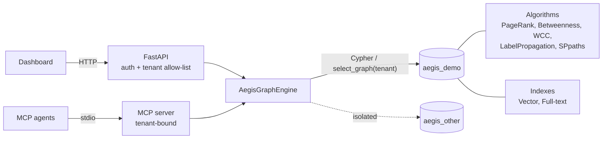
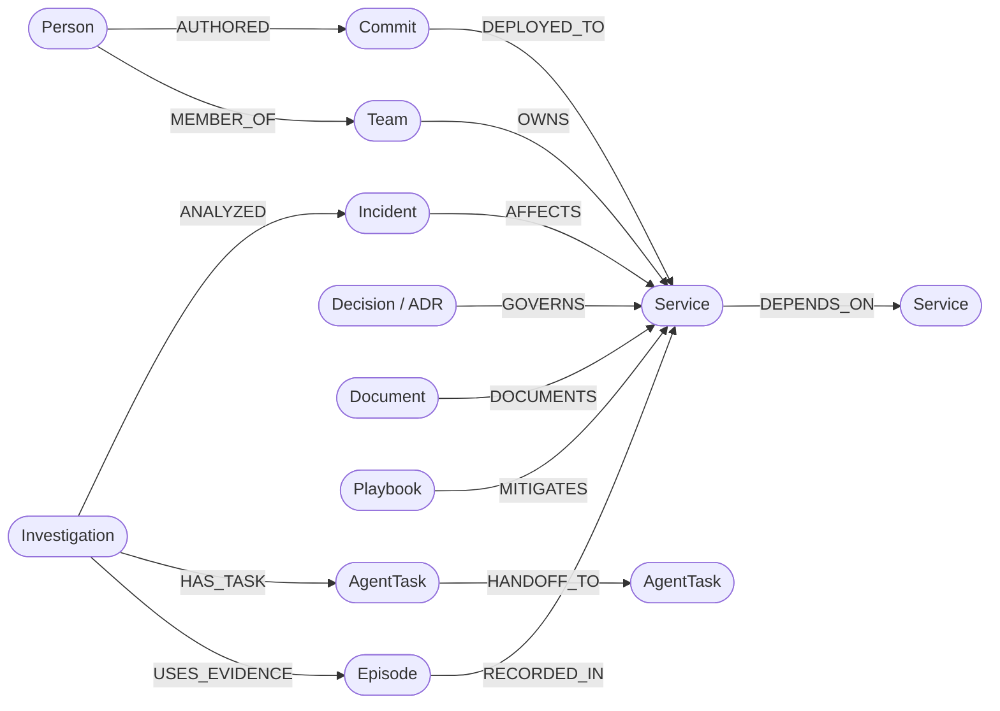
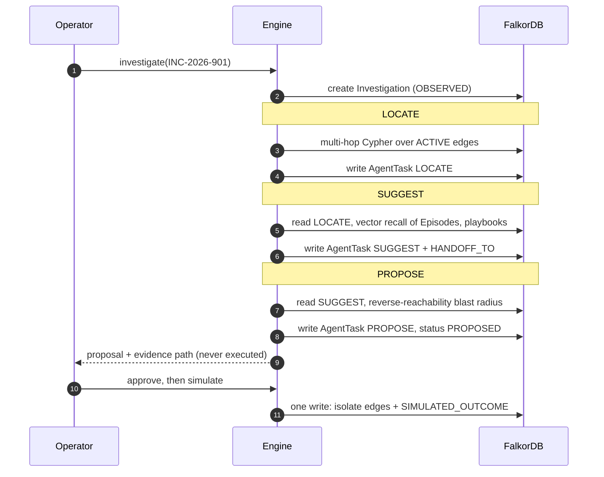
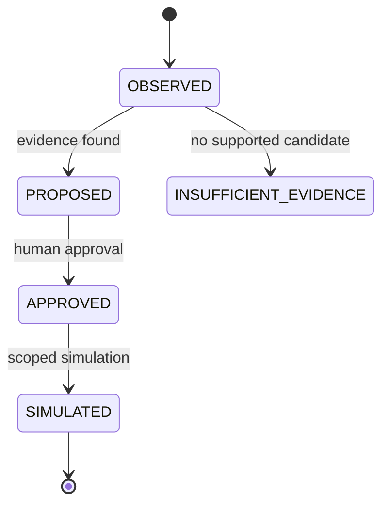

# AEGIS

**Graph-native incident investigation agent built on FalkorDB.**

[](https://www.falkordb.com/)
[](https://www.python.org/)
[](https://fastapi.tiangolo.com/)
[](https://modelcontextprotocol.io/)
[](#tests)
[](https://www.wemakedevs.org/hackathons/falkordb)

## Description

When checkout returns 504s, the cause is usually several hops downstream: a commit that removed a pool timeout, owned by another team, against an architecture decision (ADR) written a year ago. Vector search over runbooks finds text about timeouts. It cannot tell you which commit, who wrote it, who owns the service, which ADR governs it, or what breaks if you isolate it.

AEGIS stores topology, deployments, people, teams, ADRs, runbooks, playbooks and agent memory in one FalkorDB graph. It uses graph traversals and algorithms to localize a likely cause, proposes a mitigation with an evidence path, and after human approval runs a **scoped simulation** that rewires the graph.

- No evidence: returns `INSUFFICIENT_EVIDENCE`, never a guess.
- No approval: no action.
- A simulated mitigation is never recorded as a real recovery.

## Tech stack

| Layer | Technology |
|---|---|
| Graph database | FalkorDB (`falkordb/falkordb:v4.14.9`, or embedded FalkorDBLite 0.10.0) |
| Query language | Cypher (variable-length paths, vector and full-text indexes, graph algorithms) |
| Backend | Python, FastAPI, Uvicorn, Pydantic |
| Agent interface | Model Context Protocol (MCP Python SDK 2.x, stdio) |
| Frontend | Vanilla JavaScript + SVG, no build step, no CDN |
| Tooling | Docker Compose, pytest |

## Hackathon track

**Track 01: Agents That Act on Connected Data.**

| Track focus | Implementation |
|---|---|
| Multi-hop reasoning | Variable-length Cypher from incident to affected services, deployments, authors, owning teams and governing ADRs |
| Graph algorithms as agent tools | PageRank, betweenness, WCC, label propagation, weighted shortest paths via API and MCP |
| Tool selection through MCP | Tenant-bound MCP server; no raw Cypher, no approval power |
| Actions based on the graph | Mitigation derived from topology; approved simulation rewires the graph and later analysis reflects it |
| Explainable results | Evidence path, ADR, owner, author, blast radius, persisted `LOCATE → SUGGEST → PROPOSE` trace |

## Architecture



If FalkorDB is unreachable, requests fail with `503`. There is no fallback data.

## Graph model



Ownership (`OWNS`) and authorship (`AUTHORED`) are resolved separately: a commit's author is not necessarily on the owning team.

## Investigation workflow

Three stages hand off through the graph. Each reads its predecessor's persisted output, so an interrupted run resumes without redoing work.





A service/commit pair is a candidate only if: it is reachable from the incident entry point over **active** dependency edges (3 hops max); the service is `DEGRADED` or `CRITICAL`; a commit was deployed to it before the incident, within 24 hours, in the same environment; and any governing ADR is `ACCEPTED` and valid at incident time. Scores are labeled heuristics, not calibrated confidence.

## FalkorDB usage

| Feature | Use |
|---|---|
| Graph algorithms | `algo.pageRank`, `betweenness`, `WCC`, `labelPropagation`, `SPpaths` over live topology |
| Variable-length Cypher | Localization and reverse-reachability blast radius, filtered on relationship status |
| Vector index | `dimension 8, cosine` + `db.idx.vector.queryNodes` for episode recall |
| Full-text index | `db.idx.fulltext` over runbooks |
| Graph-persisted state | `AgentTask` + `HANDOFF_TO` instead of in-process variables |
| Topology mutation | `DEPENDS_ON` becomes `ISOLATED_DEPENDENCY` on approved simulation |
| Multigraph tenancy | `select_graph("aegis_<tenant>")` |
| Atomic outcome | Topology change and outcome memory in a single Cypher write |

## Quick start

Embedded, no Docker:

```sh
git clone https://github.com/krish57-bit/AEGIS.git
cd AEGIS
python3 -m venv .venv && . .venv/bin/activate
pip install -r requirements.txt falkordblite==0.10.0
GRAPH_MODE=embedded uvicorn backend.main:app --host 127.0.0.1 --port 8000
```

Open http://127.0.0.1:8000 and click **Seed demo**.

With Docker:

```sh
pip install -r requirements.txt
docker compose up -d --wait
uvicorn backend.main:app --host 127.0.0.1 --port 8000
```

`GRAPH_MODE` defaults to `remote`. Tested on macOS/arm64, Python 3.14, `falkordb==1.8.0`.

## MCP server

```sh
GRAPH_MODE=embedded python -m backend.mcp_server
```

```json
{
  "mcpServers": {
    "aegis": {
      "command": "/absolute/path/to/.venv/bin/python",
      "args": ["-m", "backend.mcp_server"],
      "cwd": "/absolute/path/to/AEGIS",
      "env": { "GRAPH_MODE": "embedded", "AEGIS_MCP_TENANT": "demo" }
    }
  }
}
```

| Tool | Purpose |
|---|---|
| `read_graph` | Topology snapshot |
| `list_incidents` | Open incidents |
| `graph_algorithms` | Algorithm results and availability |
| `investigate_incident` | Locate, suggest, propose; persists a trace |
| `read_investigation` | Read a stored trace |
| `list_memories` | Episodic memories |
| `preview_memory_retention` | Always dry-run |
| `search_company_brain` | Runbooks and ownership |

Not exposed: raw Cypher, tenant switching, approval, simulation, destructive flags.

## HTTP API

Header `X-Tenant-ID: demo` (allow-listed). Docs at `/docs`.

| Endpoint | Purpose |
|---|---|
| `GET /api/health` | Database reachability (public) |
| `POST /api/seed` | Idempotent tenant initialization |
| `GET /api/graph`, `/incidents`, `/algorithms`, `/memories` | Reads (unseeded tenant returns empty) |
| `POST /api/investigations` | Run workflow: `PROPOSED` or `INSUFFICIENT_EVIDENCE` |
| `GET /api/investigations/{id}`, `POST .../resume` | Read or resume from persisted stages |
| `POST .../{id}/approve`, `POST .../{id}/simulate` | Approval, then scoped simulation (`409` otherwise) |
| `POST /api/memories/retain` | `{threshold, dry_run: true}` |
| `GET /api/search?q=` | Full-text runbooks and ownership |

## Safety

Each property is covered by a test.

- Unknown incident returns `404`; no supported candidate returns `INSUFFICIENT_EVIDENCE` and cannot be approved.
- Simulation requires approval, touches only approved targets, and is idempotent.
- Unexecuted proposals never become success memories; outcomes are labeled `SIMULATED_OUTCOME`; telemetry and incident status are untouched.
- Retention is dry-run first, has a 24 h grace period, archives rather than deletes, and skips protected evidence.
- An interrupted investigation resumes from the persisted `LOCATE` stage.
- Optional algorithms report `available: false` instead of failing or faking scores.
- Tenant ids are validated (`[a-z][a-z0-9_]{0,47}`) and allow-listed, never rewritten.
- Loopback-only by default; non-local access requires `AEGIS_API_KEY`.

## Tests

```sh
pip install pytest
pytest                      # 6 fast tests
AEGIS_TEST_GRAPH=1 pytest   # + 7 integration tests on embedded FalkorDB
```

13 passing. The full workflow was also run manually against the `falkordb/falkordb:v4.14.9` container, an MCP stdio client, and the dashboard in Chrome.

## Configuration

| Variable | Meaning | Default |
|---|---|---|
| `GRAPH_MODE` | `remote` or `embedded` | `remote` |
| `FALKORDB_HOST` / `FALKORDB_PORT` / `FALKORDB_PASSWORD` | Remote connection | `localhost` / `6379` / none |
| `FALKORDB_PATH` | Embedded data file | `/tmp/aegisgraph.db` |
| `AEGIS_API_KEY` | `X-API-Key`; required for non-loopback access | none |
| `AEGIS_ALLOWED_TENANTS` | Tenant allow-list | `demo` |
| `AEGIS_MCP_TENANT` | Fixed MCP tenant | `demo` |

A shared key is not per-user RBAC.

## Project structure

```text
backend/
  graph_engine.py   FalkorDB engine: seed, algorithms, workflow, retention, search
  main.py           FastAPI app, auth gate, error mapping
  mcp_server.py     Tenant-bound MCP adapter
  seed.py           Synthetic demo data
frontend/index.html Dashboard
tests/              test_api.py, test_integration.py
docker-compose.yml  Pinned FalkorDB, loopback-only, persistent volume
```

## Limitations

- Deterministic stages, not LLM agents. The graph is the source of truth; an LLM layer could sit on top.
- `risk_score` is seeded demo data. Output is a ranked hypothesis with evidence, not causal proof.
- Simulation only; no live executor.
- One synthetic incident; no real telemetry ingestion.
- 8-d keyword vectors, not learned embeddings; similarity threshold is untuned.
- Task claiming is single-process.
- `algo.HarmonicCentrality` is not registered in `falkordb/falkordb:v4.14.9` or FalkorDBLite 0.10.0, so it is reported unavailable.

## Roadmap

- [ ] LLM reasoning layer that calls the same graph tools
- [ ] Telemetry ingestion (Prometheus / OpenTelemetry)
- [ ] Task leases for multi-worker coordination
- [ ] Bi-temporal facts for ownership and policy
- [ ] Per-user authentication and tenant authorization
- [ ] Learned embeddings with versioned indexes

## AI-assistance disclosure

AI coding assistance (Claude via the Backboard IDE) was used for scaffolding, the dashboard, tests and documentation. The data model, Cypher, workflow design and safety constraints were reviewed by the participant and run against real FalkorDB instances.

## References

Conceptual inspiration only; no benchmark results are claimed: [CoALA](https://arxiv.org/abs/2309.02427), [SGAgent](https://arxiv.org/abs/2602.23647), [FalkorDB](https://www.falkordb.com/), [Graph Hacks](https://www.wemakedevs.org/hackathons/falkordb).
